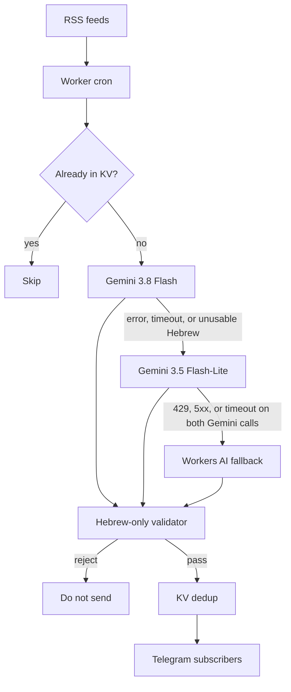

# Hebrew Finance News Bot

[](https://github.com/aviniazov7/hebrew-finance-news-bot/actions/workflows/ci.yml)
[](https://github.com/aviniazov7/hebrew-finance-news-bot/actions/workflows/ci.yml)
[](https://www.typescriptlang.org/)
[](https://workers.cloudflare.com/)

**A Telegram bot that turns global market and crypto news into short Hebrew summaries with market impact, AI-powered.**

Public RSS in, a scored Hebrew digest out. A Cloudflare Worker cron reads the feeds, a three-model fallback chain writes the summary, a Hebrew-only validator rejects bad drafts, and Workers KV stops the same story from being sent twice.

## Try it

The bot username is not stored in this repo. Until it is, the link below is a placeholder.

**Try it:** [t.me/\<BOT_USERNAME\>](https://t.me/<BOT_USERNAME>)

<!-- TODO: replace <BOT_USERNAME> with the BotFather username. It is not in the source or in wrangler config. -->

Send `/start` to subscribe. `/stop` leaves. No channel admin permission is required.

## Demo

<!-- TODO: add docs/demo.png — a screenshot of one Telegram message (Hebrew headline, short summary, market-impact line, hashtags). The file is not in the repo yet. -->

`docs/demo.png` is reserved for that screenshot. It is not committed yet, so the image is not embedded here.

Until then, this is the shape of every message (`formatTelegramMessage`):

```text
📈 מניות · כותרת בעברית

שניים או שלושה משפטים פשוטים. — CNBC

מה זה אומר לשוק: משפט אחד על התגובה האפשרית של השוק.

🎯 על מה זה משפיע: #משכנתאות #הלוואות #ריבית_על_פיקדונות

למידע בלבד. אין כאן המלצה לפעולה בשוק.
```

The last line is `DISCLAIMER`. Drafts that tell the reader to buy, sell, or invest are dropped.

## Features

- **Plain Hebrew.** Headline, two or three sentences, one line on how the market may react, three to six Hebrew hashtags, and a link to the source.
- **The whole market.** Seventeen default topics: crypto, stocks, capital markets, bonds, earnings, central banks, macro data, commodities, currencies (including the shekel), Israel, IPOs, mergers, regulation, housing, trade, tech, and banks. Defaults live in `src/catalog.ts`.
- **Crypto cannot crowd the run.** One 1–5 importance scale for every asset class. Only scores at or above `IMPORTANCE_THRESHOLD` are posted. When several topics have news, each topic is capped by `MAX_PER_CATEGORY`.
- **Model fallback.** `gemini-3.8-flash`, then `gemini-3.5-flash-lite`, then Workers AI (`WORKERS_AI_MODEL`, default `@cf/meta/llama-3.3-70b-instruct-fp8-fast`) only after both Gemini calls return 429, 5xx, or time out. Each call aborts after 18 seconds.
- **Hebrew-only validator.** Proper names are transliterated. Tickers and numbers stay. Arabic script is retried, then stripped. Unusable Hebrew is not sent and is not marked seen, so a later cron can retry it.
- **KV dedup.** Seen id, normalized URL (tracking parameters removed), and a hash of the normalized title. A pending marker is written before send, so a cron killed mid-loop does not repost. Dry-run uses its own key.
- **Subscribers.** `/start`, `/stop`, and `/help` over a secret-checked webhook. A Telegram 403 removes that chat. `TELEGRAM_CHAT_ID` optionally copies each item to one extra chat.
- **Free-tier shaped.** One cron (`*/5 * * * *`), a 45-second budget per run, a rotating feed window, and at most `MAX_ITEMS_PER_RUN` model calls. An unset or empty `DRY_RUN` stays log-only.

## Architecture



KV is checked before any model call, then written again around the send. Priority wires (Fed, ECB, Bank of England, SEC, CPI and jobs, Globes) are fetched every run. The other feeds rotate so a five-minute cron stays inside the free-plan subrequest cap.

Add a topic without a code change by setting `EXTRA_CATEGORIES` and `EXTRA_FEEDS` to JSON arrays. `FEEDS` and `CATEGORIES` replace the defaults.

## Tech stack

| Piece | Choice |
| --- | --- |
| Language | TypeScript, strict, ESM |
| Runtime | Cloudflare Workers, cron every 5 minutes |
| Storage | Workers KV (`NEWS_KV`): seen stories and the subscriber set |
| Models | Gemini 3.8 Flash, Gemini 3.5 Flash-Lite, Workers AI (Llama 3.3 70B) |
| Delivery | Telegram Bot API, webhook plus `sendMessage` |
| Tooling | Wrangler, Vitest, Node 22 |
| CI | GitHub Actions: typecheck, `npm test`, coverage |

Secrets required by `wrangler.jsonc`: `GEMINI_API_KEY`, `TELEGRAM_BOT_TOKEN`, `TELEGRAM_WEBHOOK_SECRET`. The Workers AI binding needs no key.

## Quick start

Self-host on your own Cloudflare account.

Requirements: Node 22, a Cloudflare account, a Gemini API key from [Google AI Studio](https://aistudio.google.com/), and a bot from [@BotFather](https://t.me/BotFather).

```bash
npm ci
cp .dev.vars.example .dev.vars
npx wrangler kv namespace create NEWS_KV
npx wrangler dev
```

Put the new namespace id on the `NEWS_KV` binding in `wrangler.jsonc`. In `.dev.vars`, set names only — never commit that file:

| Name | Required | Role |
| --- | --- | --- |
| `GEMINI_API_KEY` | yes | Gemini |
| `TELEGRAM_BOT_TOKEN` | yes | BotFather token |
| `TELEGRAM_WEBHOOK_SECRET` | yes | Checked on `X-Telegram-Bot-Api-Secret-Token` |
| `DRY_RUN` | local | `.dev.vars.example` keeps local runs from messaging people. The committed Worker config turns delivery on. Unset or empty stays log-only |
| `TELEGRAM_CHAT_ID` | no | Extra admin chat. Empty skips it |

Trigger a local cron (still log-only if `DRY_RUN` is unset or set as in the example file):

```bash
curl "http://localhost:8787/cdn-cgi/local/scheduled?cron=*/5+*+*+*+*"
```

`GET /health` returns `{ "ok": true }` and does not call a model.

Other tunables, names only: `IMPORTANCE_THRESHOLD`, `GEMINI_MODEL`, `GEMINI_FALLBACK_MODEL`, `WORKERS_AI_MODEL`, `MAX_ITEMS_PER_RUN`, `MAX_PER_CATEGORY`, `MAX_AGE_HOURS`, `DEDUPE_TTL_HOURS`, `FEEDS_PER_RUN`, `FEEDS`, `EXTRA_FEEDS`, `CATEGORIES`, `EXTRA_CATEGORIES`, `DISCLAIMER`. Defaults are in `wrangler.jsonc`.

### Deploy your own worker

`wrangler secret put` publishes a Worker version. Do this from your machine when you are ready.

```bash
npx wrangler secret put GEMINI_API_KEY
npx wrangler secret put TELEGRAM_BOT_TOKEN
npx wrangler secret put TELEGRAM_WEBHOOK_SECRET
npx wrangler deploy
```

Register the webhook and the Hebrew command menu. `WEBHOOK_URL` is the worker origin plus `/telegram/webhook`.

```bash
npm run telegram:setup
```

That script reads `TELEGRAM_BOT_TOKEN`, `TELEGRAM_WEBHOOK_SECRET`, and `WEBHOOK_URL`. It calls `setWebhook` with the secret, then `setMyCommands` for `/start`, `/stop`, and `/help`.

The committed `DRY_RUN` value sends messages on deploy. Pause delivery by changing that var and deploying again. Dry-run dedupe is a separate KV key, so a rehearsal does not suppress a live story.

## Testing

```bash
npm test
npm run typecheck
npm run test:coverage
```

`npm test` is Vitest. `npm run typecheck` is `tsc --noEmit`. `npm run test:coverage` repeats the suite with `@vitest/coverage-v8` and rewrites `badges/tests.svg` and `badges/coverage.svg`. The coverage badge is line coverage. CI fails if those badges drift.

The suite covers RSS and Atom parsing, KV dedupe (including a killed cron), the Gemini → Flash-Lite → Workers AI chain, Hebrew and Arabic-script checks, advice rejection, and the webhook commands.

Every pull request runs typecheck, `npm test`, and coverage on Node 22. The same job runs on each push to `main`.

`npm run samples` prints fixture messages rendered by the real formatter. They are not a live model call.

## Roadmap

- Commit `docs/demo.png` and replace the `<BOT_USERNAME>` placeholder.
- Per-subscriber topic filters. `/start` is all-or-nothing today.
- A batched digest, so a longer subscriber list still fits the Workers free-plan subrequest cap.
- More direct publisher feeds in place of the Google News searches.
- Quiet hours around the Israel trading day.
- A `LICENSE` file.

## Contributing

Issues and pull requests are welcome.

1. Branch from `main`. Use a [conventional commit](https://www.conventionalcommits.org/) (`feat`, `fix`, `docs`, `refactor`, `test`, `chore`).
2. Run `npm test` and `npm run typecheck`. If you change coverage output, run `npm run test:coverage` and commit the badge diff.
3. Do not commit `.dev.vars`, tokens, or API keys. Env examples stay names only.
4. Keep the change small. The Worker is built for the free plan: a new feed or a new model call needs a bound.

---

If this helped you, give it a star.
