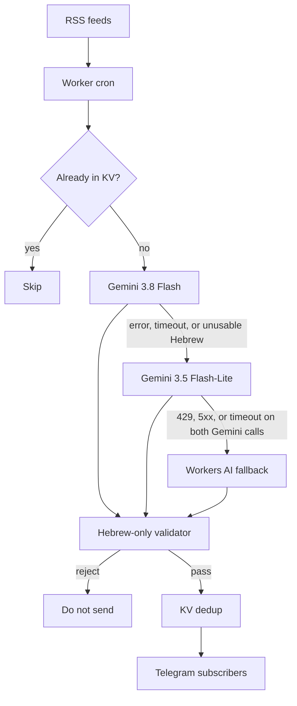

<div align="center">

# Hebrew Finance News Bot

**A Telegram bot that turns global market and crypto news into short Hebrew summaries with market impact, AI-powered.**

[](https://t.me/FinanceNewsHebBot)

[](https://github.com/aviniazov7/hebrew-finance-news-bot/actions/workflows/ci.yml)
[](https://github.com/aviniazov7/hebrew-finance-news-bot/actions/workflows/ci.yml)
[](https://www.typescriptlang.org/)
[](https://workers.cloudflare.com/)

</div>

## ✨ Why

Market headlines arrive in English. A raw translation is stiff, and a crypto-only feed misses a Fed decision, a CPI print, or a move in the shekel.

This worker reads public RSS on a schedule, scores every asset class on one scale, and sends the stories that clear the bar. Each message is everyday Hebrew: what happened, what it may mean for markets, and the hashtags for what can move. Drafts that recommend a trade, or that are not usable Hebrew, are dropped.

## 📌 Features

| | |
| --- | --- |
| **Digest** | Hebrew headline, two or three sentences, one market-impact line, three to six hashtags, a source link, and a disclaimer |
| **Coverage** | Seventeen topics in `src/catalog.ts`, from crypto and earnings to the Fed, CPI, the shekel, and Tel Aviv. One category cannot fill the run |
| **Gate** | Importance from 1 to 5. Posts at or above `IMPORTANCE_THRESHOLD`. `MAX_PER_CATEGORY` applies when several topics have news |
| **Models** | `gemini-3.8-flash`, then `gemini-3.5-flash-lite`, then Workers AI after a 429, a 5xx, or a timeout. Each call aborts after 18 seconds |
| **Hebrew check** | Names are transliterated. Tickers and numbers stay. Arabic script is retried, then stripped. Buy, sell, or invest wording is discarded |
| **Dedup** | Workers KV stores the id, the normalized URL, and a title hash. A pending marker is written before send. Dry-run uses its own key |
| **Subscribe** | `/start`, `/stop`, and `/help` on a secret-checked webhook. A Telegram 403 removes that chat |

## 🔀 Architecture



KV is checked before any model call, then written again around the send. Priority wires (Fed, ECB, Bank of England, SEC, CPI and jobs, Globes) are fetched every run. The other feeds rotate so a five-minute cron stays inside the free-plan subrequest cap.

`EXTRA_CATEGORIES` and `EXTRA_FEEDS` append a topic. `CATEGORIES` and `FEEDS` replace the defaults.

## 💬 Example

<!-- TODO: add docs/demo.png — a screenshot of a real Telegram digest. Keep this comment until the file exists. Do not embed a missing image. -->

Fixture from `src/samples.ts`, rendered by `formatTelegramMessage`. Same layout the bot sends. Not a live post.

> 🏦 **בנק מרכזי · הפד הוריד את הריבית ברבע נקודת אחוז**
>
> הבנק המרכזי של ארה״ב הוריד את הריבית ברבע נקודת אחוז. ההחלטה התקבלה אחרי שהאינפלציה התמתנה. זו הפעם השנייה השנה שהריבית יורדת. — Federal Reserve
>
> **מה זה אומר לשוק:** הורדת ריבית כזו מוזילה בדרך כלל הלוואות חדשות, ויכולה לתמוך במניות ובאג״ח, או להחליש את הדולר אם השוק קורא בה סימן לחולשה.
>
> 🎯 **על מה זה משפיע:** #משכנתאות #הלוואות #ריבית_על_פיקדונות #מניות_צמיחה_וטק #שער_הדולר_שקל #קריפטו
>
> *למידע בלבד. אין כאן המלצה לפעולה בשוק.*

## 🧰 Tech stack

| Piece | Choice |
| --- | --- |
| Language | TypeScript, strict, ESM |
| Runtime | Cloudflare Workers, cron every 5 minutes |
| Storage | Workers KV (`NEWS_KV`): seen stories and subscribers |
| Models | Gemini 3.8 Flash, Gemini 3.5 Flash-Lite, Workers AI (Llama 3.3 70B) |
| Delivery | Telegram Bot API. Live bot: [t.me/FinanceNewsHebBot](https://t.me/FinanceNewsHebBot) |
| Tooling | Wrangler, Vitest, Node 22 |
| CI | GitHub Actions: typecheck, `npm test`, coverage |

Secrets named in `wrangler.jsonc`: `GEMINI_API_KEY`, `TELEGRAM_BOT_TOKEN`, `TELEGRAM_WEBHOOK_SECRET`. The Workers AI binding needs no key.

## ⚡ Quick start

Self-host on your own Cloudflare account. Node 22, a Gemini API key from [Google AI Studio](https://aistudio.google.com/), and a bot from [@BotFather](https://t.me/BotFather).

```bash
npm ci
cp .dev.vars.example .dev.vars
npx wrangler kv namespace create NEWS_KV
npx wrangler dev
```

Point the `NEWS_KV` binding in `wrangler.jsonc` at the new namespace. Set these names in `.dev.vars`, and do not commit that file:

| Name | Required | Role |
| --- | --- | --- |
| `GEMINI_API_KEY` | yes | Gemini |
| `TELEGRAM_BOT_TOKEN` | yes | BotFather token |
| `TELEGRAM_WEBHOOK_SECRET` | yes | Checked on `X-Telegram-Bot-Api-Secret-Token` |
| `DRY_RUN` | local | `.dev.vars.example` keeps local runs from messaging people. The committed Worker config turns delivery on. Unset or empty stays log-only |
| `TELEGRAM_CHAT_ID` | no | Extra admin chat. Empty skips it |

```bash
curl "http://localhost:8787/cdn-cgi/local/scheduled?cron=*/5+*+*+*+*"
```

`GET /health` returns JSON with `ok: true` and does not call a model.

Other names, with defaults in `wrangler.jsonc`: `IMPORTANCE_THRESHOLD`, `GEMINI_MODEL`, `GEMINI_FALLBACK_MODEL`, `WORKERS_AI_MODEL`, `MAX_ITEMS_PER_RUN`, `MAX_PER_CATEGORY`, `MAX_AGE_HOURS`, `DEDUPE_TTL_HOURS`, `FEEDS_PER_RUN`, `FEEDS`, `EXTRA_FEEDS`, `CATEGORIES`, `EXTRA_CATEGORIES`, `DISCLAIMER`.

Publish from your own machine when you are ready. `wrangler secret put` ships a Worker version.

```bash
npx wrangler secret put GEMINI_API_KEY
npx wrangler secret put TELEGRAM_BOT_TOKEN
npx wrangler secret put TELEGRAM_WEBHOOK_SECRET
npx wrangler deploy
npm run telegram:setup
```

`telegram:setup` reads `TELEGRAM_BOT_TOKEN`, `TELEGRAM_WEBHOOK_SECRET`, and `WEBHOOK_URL` (the worker origin plus `/telegram/webhook`). It registers the webhook secret and the Hebrew menu for `/start`, `/stop`, and `/help`.

The committed `DRY_RUN` value sends messages on deploy. Pause delivery by changing that var and deploying again. Dry-run dedupe is a separate KV key, so a rehearsal does not suppress a live story.

## ✅ Tests

```bash
npm test
npm run typecheck
npm run test:coverage
```

`npm test` is Vitest. `npm run typecheck` is `tsc --noEmit`. `npm run test:coverage` repeats the suite with `@vitest/coverage-v8` and rewrites the tests and coverage badges. The coverage badge is line coverage. CI fails if those badges drift.

The suite covers RSS and Atom parsing, KV dedupe (including a killed cron), the model fallback chain, Hebrew and Arabic-script checks, advice rejection, and the webhook commands. Every pull request and every push to `main` runs typecheck, tests, and coverage on Node 22.

`npm run samples` prints every fixture through the real formatter.

Pull requests are welcome. Use a conventional commit, run the checks above, and leave secrets out of git.

## 🗺️ Roadmap

- [ ] Add `docs/demo.png`, a screenshot of a real digest
- [ ] Per-subscriber topic filters
- [ ] A batched digest for longer subscriber lists
- [ ] More direct publisher feeds in place of Google News searches
- [ ] Quiet hours around the Israel trading day
- [ ] A `LICENSE` file

## 👤 Author

**Avraham Niazov** — [GitHub](https://github.com/aviniazov7) · [Telegram](https://t.me/aviniazov7)

<div align="center">

**If this helped you, give it a star.**

[](https://github.com/aviniazov7/hebrew-finance-news-bot/stargazers)

</div>
