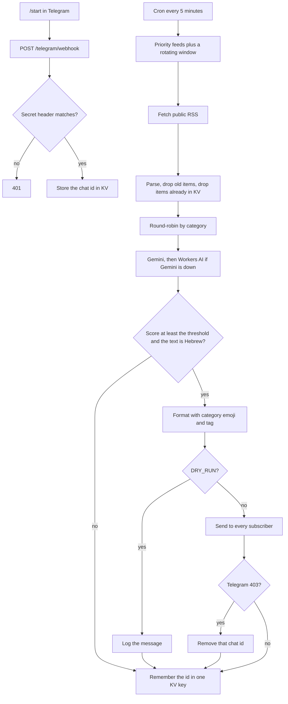

# Hebrew Finance News Bot

[](https://github.com/aviniazov7/hebrew-finance-news-bot/actions/workflows/ci.yml)
[](https://github.com/aviniazov7/hebrew-finance-news-bot/actions/workflows/ci.yml)
[](https://github.com/aviniazov7/hebrew-finance-news-bot/actions/workflows/ci.yml)

A Cloudflare Worker that watches public finance RSS feeds and sends the stories that matter to Telegram subscribers, in plain Hebrew. Anyone can open the bot and send `/start`. Each message has a short summary, one line on what it may mean for markets, a short list of what the news can affect, and a glossary for jargon such as “hedge fund”, “CPI”, or “rate cut”.

It covers the whole market, not a crypto feed with a few other headlines mixed in: stocks, capital markets, bonds and yields, earnings, the Fed and other central banks, CPI and jobs, commodities, currencies (including the shekel), Israel, IPOs, mergers, regulation, housing, trade and tariffs, big tech, and banks.

The worker deployed from this repo is **live**: `wrangler.jsonc` sets `DRY_RUN` to `false`, so each accepted story is sent to subscribers. A missing `DRY_RUN` value still means dry-run, which is what the tests use. For local `wrangler dev`, copy `.dev.vars.example` and set `DRY_RUN=true` if you do not want to message people. `/start`, `/stop`, and `/help` always reply. No API keys live in the repo.

## Architecture



Gemini is called with `gemini-3.8-flash`. If the reply is not usable Hebrew, the worker asks again, then falls back to `gemini-3.5-flash-lite`. A Fed story is not retagged as crypto unless the text is actually about crypto.

If both of those calls fail with HTTP 429, a 5xx response, or a timeout, the worker asks Workers AI (`WORKERS_AI_MODEL`, default `@cf/meta/llama-3.3-70b-instruct-fp8-fast`, Llama 3.3 70B instruct). That model is the current Llama flagship on Workers AI and is large enough for everyday Hebrew. The smaller Llama 3.2 instruct models are multilingual but too small to trust for this. The same JSON schema and Hebrew checks apply. Output that fails those checks is not sent, and the item is not marked seen. When every model fails, the item is also left unseen, so a later cron retries it while it is still inside `MAX_AGE_HOURS`. Each accepted analysis logs the model id that wrote it.

## Why crypto does not crowd out other news

Two separate limits do this:

- **Scoring.** The prompt uses one 1–5 scale for every asset class. A loud token headline is not more important than a Fed decision, a CPI print, a large earnings surprise, or a move in the shekel. Only scores at or above `IMPORTANCE_THRESHOLD` (default **4**) are posted.
- **Selection.** When more than one category has fresh items, each category can contribute at most `MAX_PER_CATEGORY` items (default **2**) to that run. CoinDesk and Cointelegraph share the single `crypto` category, so a backlog of token stories cannot fill the Gemini quota. On a quiet day, if only one category has news, it may use the full `MAX_ITEMS_PER_RUN` (default **5**).

## Categories and sources

The emoji is the topic, not a green or red arrow. Defaults live in `src/catalog.ts`. Replace them with `FEEDS` / `CATEGORIES`, or append with `EXTRA_FEEDS` / `EXTRA_CATEGORIES`.

| Category | Tag | Default sources |
| --- | --- | --- |
| Crypto | ₿ קריפטו | CoinDesk, Cointelegraph |
| Stocks | 📈 מניות | CNBC Finance |
| Capital markets | 📰 שוקי הון | MarketWatch top stories |
| Bonds and yields | 💵 אג״ח | Google News search for Treasury and government-bond yields |
| Earnings | 📊 דוחות | CNBC Earnings |
| Central banks | 🏦 בנק מרכזי | Federal Reserve, ECB, and Bank of England press RSS |
| Macro data | 📋 מאקרו | CNBC Economy, plus a Google News search for CPI and the jobs report |
| Commodities | 🛢️ סחורות | CNBC Energy, plus a Google News search for gold, silver, crude, and natural gas |
| Currencies | 💱 מט״ח | Google News search for the dollar, EUR/USD, and the shekel |
| Israel | 🇮🇱 ישראל | Globes capital-markets RSS, plus a Google News search for the Bank of Israel and the TASE |
| IPOs | 🔔 הנפקות | Google News search for IPO filings and pricing |
| Mergers | 🤝 מיזוגים | Google News search for merger agreements and takeover bids |
| Regulation | ⚖️ רגולציה | SEC press releases |
| Housing | 🏠 נדל״ן | CNBC Real Estate |
| Trade and geopolitics | 🌍 סחר ועולם | Google News search for tariffs, trade wars, and sanctions |
| Tech and AI | 🤖 טק ו-AI | CNBC Tech |
| Banks and fintech | 🏛️ בנקים | Google News search for bank earnings, fintech, and investment banking |

Feeds were checked in October 2026. The Bureau of Labor Statistics blocks anonymous RSS clients, and the Bank of Israel site does not expose a working public feed, so CPI, jobs, and Israeli policy use the publisher and Google News sources above. Google News is a headline aggregator (Reuters and others), used only where a stable publisher feed was not available. Priority wires (Fed, ECB, Bank of England, SEC, CPI/jobs, Globes) are fetched on every run. The other feeds rotate, 12 URLs per run by default, so a five-minute cron stays inside the free-plan subrequest cap. A story missed on one pass is still inside the 18-hour age window.

Add a topic without editing code:

```json
[{"id":"private-credit","emoji":"🏦","labelHe":"אשראי פרטי","labelEn":"Private credit"}]
```

```json
[{"name":"Private credit","url":"https://news.google.com/rss/search?q=%22private%20credit%22&hl=en-US&gl=US&ceid=US:en","category":"private-credit"}]
```

Put the first document in `EXTRA_CATEGORIES` and the second in `EXTRA_FEEDS`.

## Message format

```text
📈 מניות · כותרת בעברית

שניים או שלושה משפטים פשוטים.

מה זה אומר לשוק: משפט אחד על התגובה האפשרית של השוק.

🎯 על מה זה משפיע: משכנתאות, הלוואות, ריבית על פיקדונות, מניות צמיחה וטק

מילון: קרן גידור (hedge fund) — הסבר קצר בעברית.

מקור: CNBC Finance — https://example.com/story

למידע בלבד. אין כאן המלצה לפעולה בשוק.
```

The affects line always lists three to six concrete things in simple Hebrew, separated by commas. Gemini writes that list. If the model omits it, or fewer than three phrases pass the Hebrew check, the worker uses a built-in list for that category (a rate decision falls back to mortgages, loans, deposit rates, growth stocks, the dollar-shekel rate, and crypto). Topics added through config use a general list: stock indexes, government bonds, exchange rates, the cost of credit, and risk appetite. The glossary line is omitted when the story has no jargon. The disclaimer is `DISCLAIMER`. The model is told not to recommend buying, selling, or investing, and a draft that does is discarded.

## Free-tier shape

This is built for the Workers free plan and the Gemini free tier. It does not provision paid resources.

- One cron, `*/5 * * * *`. The free plan allows 5 cron triggers per account. CPU time on the free plan is 10 ms per cron; time spent waiting on RSS, Gemini, Telegram, and KV does not count. Bodies are capped and each feed keeps only a few items so parsing stays small.
- One seen key (`seen:v1`, or `seen:dry-run:v1` while dry-run is on) and one subscriber key (`subscribers:v1`). A cron reads each once and writes only when the set changes. `/start` and `/stop` write the subscriber key when the set changes. The free plan allows 1,000 writes per day and one write per second to the same key. Seen ids expire after 72 hours.
- At most 5 stories per run by default, so a quiet day does not burn the Gemini quota. A Gemini 429, 5xx, or timeout tries the fallback Gemini model and then one Workers AI call. If all of them fail, or Workers AI returns text that fails the Hebrew check, the story is not marked seen and the next cron tries again until it is older than `MAX_AGE_HOURS`. A Gemini reply that is not usable Hebrew, after the Hebrew retry, is remembered so the same bad draft is not scored forever. A Telegram 403 removes that subscriber and the item is still remembered. Workers AI has its own daily allowance and is not on the Gemini quota.
- 50 subrequests per invocation on the free plan. Each news item is one `sendMessage` per subscriber, with a 40 ms gap (about 25 messages per second). A handful of subscribers fits next to the feed fetches. A long list does not fit in one free-plan cron. Feeds are fetched four at a time because the free plan allows 6 simultaneous outgoing connections.

## Setup

Requirements: Node 22, a Cloudflare account, a Gemini API key from Google AI Studio, and a Telegram bot from [@BotFather](https://t.me/BotFather) (`/newbot`). People subscribe by sending `/start` to the bot. No channel admin permission is required.

```bash
npm ci
cp .dev.vars.example .dev.vars
# fill GEMINI_API_KEY, TELEGRAM_BOT_TOKEN, and TELEGRAM_WEBHOOK_SECRET in .dev.vars
npx wrangler kv namespace create NEWS_KV
```

`NEWS_KV` in `wrangler.jsonc` is the production namespace `1c14e28c5aad45ad8c8d388e441cee52`. Do not replace it with a placeholder.

`TELEGRAM_CHAT_ID` is optional. Set it to your own numeric chat id, or an `@username`, if you also want every item copied there.

Local cron, still in dry-run:

```bash
npx wrangler dev
curl "http://localhost:8787/cdn-cgi/local/scheduled?cron=*/5+*+*+*+*"
```

`GET /health` returns `{ "ok": true, "dryRun": true }` and does not call Gemini.

## Deploy

Do this from your own machine when you are ready. `wrangler secret put` publishes a new Worker version.

```bash
npx wrangler deploy
npx wrangler secret put GEMINI_API_KEY
npx wrangler secret put TELEGRAM_BOT_TOKEN
npx wrangler secret put TELEGRAM_WEBHOOK_SECRET
npx wrangler tail
```

`wrangler secret put` publishes a Worker version. Put the same `TELEGRAM_WEBHOOK_SECRET` value in the setup command below. Telegram sends it on every webhook request as `X-Telegram-Bot-Api-Secret-Token`.

After the worker is deployed, register the webhook and the Hebrew command menu. `WEBHOOK_URL` is the worker origin plus `/telegram/webhook`.

```bash
export TELEGRAM_BOT_TOKEN=...
export TELEGRAM_WEBHOOK_SECRET=...
export WEBHOOK_URL=https://hebrew-finance-news-bot.<account>.workers.dev/telegram/webhook
npm run telegram:setup
```

That calls `setWebhook` with `secret_token`, then `setMyCommands` for `/start`, `/stop`, and `/help`.

`DRY_RUN` in `wrangler.jsonc` is `"false"` because this bot is already live. A deploy from `main` keeps sending. Set it back to `"true"` and deploy only when you want to pause delivery. Dry-run dedupe is stored separately, so turning the flag off does not suppress stories you only logged.

You can also add the three secrets in the dashboard (Workers & Pages → the worker → Settings → Variables and Secrets) before the first deploy.

## Configuration

| Variable | Default | Role |
| --- | --- | --- |
| `DRY_RUN` | `false` in `wrangler.jsonc` | Production sends. Missing or empty still means log-only. Command replies always go out |
| `IMPORTANCE_THRESHOLD` | `4` | Post only scores from 1–5 at or above this |
| `DISCLAIMER` | short Hebrew sentence | Appended to every message. Empty string omits it |
| `GEMINI_MODEL` | `gemini-3.8-flash` | Main model |
| `GEMINI_FALLBACK_MODEL` | `gemini-3.5-flash-lite` | Used when the main model fails or will not answer in Hebrew |
| `WORKERS_AI_MODEL` | `@cf/meta/llama-3.3-70b-instruct-fp8-fast` | Third model, only after both Gemini calls return 429, 5xx, or time out |
| `MAX_ITEMS_PER_RUN` | `5` | Model calls per cron |
| `MAX_PER_CATEGORY` | `2` | Cap per topic when several topics have news |
| `MAX_ITEMS_PER_FEED` | `4` | Items parsed from the top of each feed |
| `MAX_AGE_HOURS` | `18` | Ignore older items |
| `DEDUPE_TTL_HOURS` | `72` | How long a seen id is remembered |
| `FEEDS_PER_RUN` | `12` | URLs fetched per cron. `0` fetches every feed |
| `FEEDS` / `CATEGORIES` | empty | JSON arrays that replace the defaults |
| `EXTRA_FEEDS` / `EXTRA_CATEGORIES` | empty | JSON arrays appended to the active lists |
| `GEMINI_API_KEY` | secret | Gemini API key |
| `TELEGRAM_BOT_TOKEN` | secret | Bot token from BotFather |
| `TELEGRAM_WEBHOOK_SECRET` | secret | Shared secret for `X-Telegram-Bot-Api-Secret-Token` |
| `TELEGRAM_CHAT_ID` | empty | Optional admin chat. A numeric id or `@username`. Empty skips it |
| `NEWS_KV` | KV binding `1c14e28c5aad45ad8c8d388e441cee52` | Seen items and the subscriber set |
| `AI` | Workers AI binding | Llama fallback. No API key |

Secrets are declared in `wrangler.jsonc` under `secrets.required` and are not given values in git. `TELEGRAM_CHAT_ID` is a var, not a required secret.

## Testing

```bash
npm test
npm run typecheck
npm run test:coverage
```

`npm test` runs Vitest. `npm run typecheck` is `tsc --noEmit`. `npm run test:coverage` repeats the suite with `@vitest/coverage-v8` and rewrites the tests and coverage badges above. The coverage badge is line coverage.

The suite covers:

- **Parsing.** RSS and Atom feeds, including CDATA, entities, dates, and Hebrew titles.
- **Dedupe.** Seen ids in KV, the TTL, and a separate dry-run key so a rehearsal does not suppress a live story.
- **Model fallback.** Gemini, then Gemini lite, then Workers AI. A draft that is not usable Hebrew is requested again from Gemini and, if that is still unusable, from Gemini lite. HTTP 429, a 5xx response, or a timeout on both Gemini calls is the only path to Workers AI. An auth failure stops the chain. Text that still fails the Hebrew check is not sent.
- **Hebrew output validation.** The headline, summary, and market line must be Hebrew. Wording that tells the reader to buy, sell, or invest is dropped. An affects list keeps three to six Hebrew phrases.
- **Subscriber commands.** `/start`, `/stop`, and `/help`, an unknown command, the webhook secret, and removal of a chat that blocks the bot.

Every pull request runs the tests before merge. The [CI workflow](https://github.com/aviniazov7/hebrew-finance-news-bot/actions/workflows/ci.yml) also runs on each push to `main`: Node 22, `npm ci`, typecheck, `npm test`, then the coverage run. The job prints a coverage summary, and the badges have to match that run.

`npm run samples` prints the fixture messages below.

## Fixture samples

These messages are **not** a live Gemini call and **not** live news. No `GEMINI_API_KEY` was available in the build environment. They are illustrative drafts rendered by `formatTelegramMessage`, the same function the worker uses. Regenerate them with `npm run samples`.

### Crypto

```text
₿ קריפטו · ביטקוין נחלש אחרי אזהרת רגולציה בארה״ב

רגולטור בארה״ב הודיע שיבדוק כמה בורסות קריפטו גדולות. ביטקוין ירד תוך שעות, ויחד איתו נחלשו גם מטבעות גדולים אחרים. בשלב הזה לא פורסם קנס ולא צו סגירה.

מה זה אומר לשוק: כשיוצאת אזהרת רגולציה חדה, מחירי הקריפטו נוטים לזוז מהר, ולפעמים גם מניות של חברות שמחזיקות ביטקוין זזות איתם.

🎯 על מה זה משפיע: ביטקוין, מטבעות גדולים, מניות חברות שמחזיקות ביטקוין, קרנות סל על ביטקוין, בורסות קריפטו

מילון: קרן סל (ETF) — מוצר שנסחר בבורסה כמו מניה ועוקב אחרי מדד או אחרי ביטקוין, בלי שצריך לקנות את המטבע עצמו.

מקור: CoinDesk — https://example.com/fixtures/crypto

למידע בלבד. אין כאן המלצה לפעולה בשוק.
```

### Stocks

```text
📈 מניות · וול סטריט נסגרה בירידות אחרי דוחות מעורבים

מדדי המניות הגדולים בארה״ב ירדו ביום מסחר שבו חלק מהחברות עקפו את תחזית הרווח וחלק פספסו. ירידות חדות יותר נראו במניות שבבים. לא פורסם אירוע חירום במסחר.

מה זה אומר לשוק: יום מעורב כזה בדרך כלל מגדיל את התנודות במדדים, בלי לשנות לבד את כיוון הריבית או את שוק האג״ח.

🎯 על מה זה משפיע: מדדי וול סטריט, מניות שבבים, תחזיות רווח, תנודתיות במסחר, אג״ח

מילון: מדד (index) — מספר שמרכז את מחירי קבוצת מניות, למשל 500 החברות הגדולות בארה״ב, כדי לראות איך השוק זז.

מקור: CNBC Finance — https://example.com/fixtures/stocks

למידע בלבד. אין כאן המלצה לפעולה בשוק.
```

### Capital markets

```text
📰 שוקי הון · שוקי ההון נערכים ליום מסחר תנודתי סביב החלטת ריבית

סוחרים הזיזו כסף בין מניות לאג״ח לקראת החלטת הבנק המרכזי. מחזורי המסחר עלו כבר לפני ההודעה. אין עדיין החלטה רשמית.

מה זה אומר לשוק: ככל שההחלטה מתקרבת, פערי המחירים בין קונים למוכרים יכולים להתרחב, ולכן תנועה חדה בשני הכיוונים אפשרית מיד אחרי ההודעה.

🎯 על מה זה משפיע: מניות, אג״ח, מרווחי קנייה ומכירה, מחזורי מסחר, שערי מטבע

מילון: נזילות (liquidity) — כמה קל לקנות או למכור נכס בלי להזיז את המחיר שלו בצורה חדה.

מקור: MarketWatch — https://example.com/fixtures/markets

למידע בלבד. אין כאן המלצה לפעולה בשוק.
```

### Bonds

```text
💵 אג״ח · התשואה על אג״ח ממשלת ארה״ב לעשר שנים עלתה

מחיר האג״ח הארוכות ירד, ולכן התשואה עליהן עלתה. העלייה הגיעה אחרי נתונים שהראו שהכלכלה עדיין חזקה. אג״ח קצרות יותר זזו פחות.

מה זה אומר לשוק: תשואה גבוהה יותר על אג״ח ממשלתיות מייקרת את עלות הגיוס של ממשלות וחברות, ויכולה ללחוץ על מחירי מניות.

🎯 על מה זה משפיע: אג״ח לעשר שנים, עלות גיוס של חברות, מחירי מניות, ריבית משכנתאות, שער הדולר

מילון: תשואה (yield) — הריבית שמקבל מי שמחזיק באג״ח אם הוא מחזיק בה עד הסוף. כשמחיר האג״ח יורד, התשואה עולה.

מקור: Google News — bonds — https://example.com/fixtures/bonds

למידע בלבד. אין כאן המלצה לפעולה בשוק.
```

### Earnings

```text
📊 דוחות · ענקית טכנולוגיה עקפה את תחזית הרווח והזהירה מהוצאות גבוהות

החברה דיווחה על רווח גבוה מהתחזית ברבעון האחרון. במקביל היא אמרה שתוציא יותר על תשתיות בשנה הקרובה. המניה זזה חזק אחרי הסגירה.

מה זה אומר לשוק: דוח כזה יכול למשוך את כל סקטור הטכנולוגיה, כי משקיעים מעדכנים לפיו את הציפיות גם מחברות דומות.

🎯 על מה זה משפיע: מניית החברה, מניות הטכנולוגיה, תחזיות רווח, הוצאות על תשתיות, מדדי המניות

מילון: רווח למניה (EPS) — הרווח של החברה מחולק במספר המניות. כך משווים בין חברות בגדלים שונים.

מקור: CNBC Earnings — https://example.com/fixtures/earnings

למידע בלבד. אין כאן המלצה לפעולה בשוק.
```

### Central banks

```text
🏦 בנק מרכזי · הפד הוריד את הריבית ברבע נקודת אחוז

הבנק המרכזי של ארה״ב הוריד את הריבית ברבע נקודת אחוז. ההחלטה התקבלה אחרי שהאינפלציה התמתנה. זו הפעם השנייה השנה שהריבית יורדת.

מה זה אומר לשוק: הורדת ריבית כזו מוזילה בדרך כלל הלוואות חדשות, ויכולה לתמוך במניות ובאג״ח, או להחליש את הדולר אם השוק קורא בה סימן לחולשה.

🎯 על מה זה משפיע: משכנתאות, הלוואות, ריבית על פיקדונות, מניות צמיחה וטק, שער הדולר-שקל, קריפטו

מילון: הורדת ריבית (rate cut) — הבנק המרכזי מוזיל את מחיר הכסף כדי לעודד פעילות בכלכלה.

מקור: Federal Reserve — https://example.com/fixtures/fed

למידע בלבד. אין כאן המלצה לפעולה בשוק.
```

### Macro data

```text
📋 מאקרו · מדד המחירים לצרכן עלה פחות מהצפוי

מדד המחירים לצרכן בארה״ב עלה בקצב איטי יותר ממה שהכלכלנים צפו. גם המדד בלי מזון ואנרגיה התקרר. שוק העבודה לא השתנה בהודעה הזו.

מה זה אומר לשוק: הפתעה כלפי מטה במדד כזה בדרך כלל מורידה ציפיות להעלאת ריבית, ולכן אג״ח ומניות יכולות לעלות מיד אחרי הפרסום.

🎯 על מה זה משפיע: ציפיות לריבית, אג״ח ממשלתיות, מדדי מניות, שער הדולר, מחירי הזהב

מילון: מדד המחירים לצרכן (CPI) — מדד שמראה בכמה התייקרו הקניות של משק בית רגיל.; דוח תעסוקה (jobs report) — הפרסום החודשי שמראה כמה משרות נוספו וכמה אנשים מחפשים עבודה.

מקור: CNBC Economy — https://example.com/fixtures/macro

למידע בלבד. אין כאן המלצה לפעולה בשוק.
```

### Commodities

```text
🛢️ סחורות · מחיר הנפט עלה בגלל חשש משיבוש באספקה

מחיר חבית נפט גולמי עלה אחרי דיווחים על שיבוש אפשרי בהובלה. גם מחירי הגז זזו באותו כיוון. הזהב נשאר יציב יחסית באותו יום.

מה זה אומר לשוק: נפט יקר יותר יכול להעלות עלויות של חברות תעופה ותחבורה, ולפעמים גם את ציפיות האינפלציה.

🎯 על מה זה משפיע: מחיר הנפט, מחיר הגז, חברות תעופה, עלויות תחבורה, ציפיות לאינפלציה

מילון: חבית (barrel) — יחידת המדידה המקובלת לנפט גולמי בשוק העולמי.

מקור: CNBC Energy — https://example.com/fixtures/commodities

למידע בלבד. אין כאן המלצה לפעולה בשוק.
```

### Currencies

```text
💱 מט״ח · השקל נחלש מול הדולר והאירו

הדולר והאירו התחזקו מול השקל במסחר היום. התנועה הגיעה בלי החלטת ריבית חדשה בישראל. מטבעות אחרים של שווקים קטנים זזו בצורה מתונה.

מה זה אומר לשוק: שקל חלש יותר מייקר יבוא ומחירי נסיעות לחו״ל, ויכול לתמוך בחברות ישראליות שמוכרות בדולרים.

🎯 על מה זה משפיע: שער הדולר-שקל, שער האירו-שקל, מחירי יבוא, נסיעות לחו״ל, חברות שמוכרות בדולרים

מילון: שער חליפין (exchange rate) — כמה יחידות ממטבע אחד צריך כדי לקנות מטבע אחר, למשל כמה שקלים שווים דולר אחד.

מקור: Google News — currencies — https://example.com/fixtures/forex

למידע בלבד. אין כאן המלצה לפעולה בשוק.
```

### Israel

```text
🇮🇱 ישראל · בנק ישראל השאיר את הריבית ללא שינוי

בנק ישראל החליט לא לשנות את הריבית. הנגיד אמר שהאינפלציה עדיין מעל היעד. מדד תל אביב 35 נע סביב ההודעה בלי כיוון חד.

מה זה אומר לשוק: ריבית ללא שינוי משאירה את עלות המשכנתאות והאשראי העסקי קרובה לרמה הנוכחית, והשוק יחפש רמזים להחלטה הבאה.

🎯 על מה זה משפיע: משכנתאות, הלוואות, ריבית על פיקדונות, מדד תל אביב, שער הדולר-שקל, מניות הבנקים

מילון: ריבית בנק ישראל (policy rate) — הריבית שבה הבנק המרכזי מלווה כסף לבנקים. היא משפיעה על פיקדונות, משכנתאות והלוואות.

מקור: Globes — https://example.com/fixtures/israel

למידע בלבד. אין כאן המלצה לפעולה בשוק.
```

### IPOs

```text
🔔 הנפקות · חברת תוכנה הגישה תשקיף לקראת הנפקה

החברה הגישה מסמכים כדי למכור מניות לציבור בפעם הראשונה. עוד לא נקבע המחיר הסופי ולא התאריך. בתשקיף היא תיארה הפסד בשנה האחרונה.

מה זה אומר לשוק: הנפקה גדולה יכולה למשוך כסף ממניות אחרות באותו סקטור ביום המסחר הראשון, כי קונים מפנים מזומן לעסקה החדשה.

🎯 על מה זה משפיע: מניות תוכנה, כסף פנוי של משקיעים, בנקים מובילי ההנפקה, שוק ההנפקות, מדדי המניות

מילון: הנפקה ראשונית (IPO) — הפעם הראשונה שחברה מוכרת מניות לציבור והמניה מתחילה להיסחר בבורסה.

מקור: Google News — IPOs — https://example.com/fixtures/ipo

למידע בלבד. אין כאן המלצה לפעולה בשוק.
```

### Mergers

```text
🤝 מיזוגים · ענקית תרופות תרכוש מתחרה קטנה יותר

החברה הודיעה שתרכוש חברה אחרת בעסקה של כמה מיליארדי דולרים. העסקה עוד צריכה אישור של רגולטורים. מניית החברה הנרכשת עלתה, ומניית הרוכשת ירדה מעט.

מה זה אומר לשוק: בעסקאות כאלה המניה הנרכשת בדרך כלל מתקרבת למחיר שהוצע, והרוכשת זזה לפי החשש מתשלום גבוה מדי או מחיסכון עתידי בעלויות.

🎯 על מה זה משפיע: מניית הנרכשת, מניית הרוכשת, מניות תרופות, אישורי רגולציה, אג״ח של החברות

מילון: מיזוג ורכישה (M&A) — עסקה שבה חברה קונה חברה אחרת, או ששתי חברות מתאחדות לחברה אחת.

מקור: Google News — M&A — https://example.com/fixtures/ma

למידע בלבד. אין כאן המלצה לפעולה בשוק.
```

### Regulation

```text
⚖️ רגולציה · רשות ניירות ערך בארה״ב פתחה בבדיקה של קרן גדולה

הרשות הודיעה שפתחה בבדיקה של דיווחים לציבור בקרן השקעות גדולה. לא הוגש כתב אישום. החברה אמרה שהיא משתפת פעולה.

מה זה אומר לשוק: בדיקה כזו יכולה ללחוץ על מניית החברה ועל קרנות דומות, כל עוד לא ברור אם יהיה קנס או רק דרישה לתיקון דיווחים.

🎯 על מה זה משפיע: מניית הקרן, קרנות דומות, דיווחים לציבור, קנסות אפשריים, אמון המשקיעים

מילון: הרשות לניירות ערך (SEC) — הגוף בארה״ב שמפקח על הבורסות ועל המידע שחברות חייבות לפרסם למשקיעים.

מקור: SEC — https://example.com/fixtures/regulation

למידע בלבד. אין כאן המלצה לפעולה בשוק.
```

### Housing

```text
🏠 נדל״ן · מכירות הבתים בארה״ב הואטו כשריבית המשכנתא נשארה גבוהה

מספר הבתים שנמכרו ירד לעומת החודש הקודם. ריבית המשכנתא ל-30 שנה כמעט לא זזה. מלאי הבתים למכירה עלה מעט.

מה זה אומר לשוק: שוק דיור איטי יותר יכול לקרר הוצאות של משקי בית ואת הביקוש למוצרי בית, ולהשפיע על הציפיות להורדת ריבית.

🎯 על מה זה משפיע: ריבית משכנתא, מכירות בתים, מניות חברות בנייה, הוצאות משק הבית, ציפיות לריבית

מילון: ריבית משכנתא (mortgage rate) — הריבית על הלוואה לקניית דירה. כשהיא גבוהה, ההחזר החודשי יקר יותר ופחות קונים נכנסים לשוק.

מקור: CNBC Real Estate — https://example.com/fixtures/housing

למידע בלבד. אין כאן המלצה לפעולה בשוק.
```

### Trade and geopolitics

```text
🌍 סחר ועולם · איום במכסים חדשים טלטל מניות של יצואנים

איום להטיל מכסים על יבוא ממדינה גדולה הוריד מניות של חברות שמוכרות לשם. גם מטבע של אותה מדינה נחלש. עדיין לא נחתם צו רשמי.

מה זה אומר לשוק: מכס חדש יכול לייקר מוצרים, לחתוך רווחים של יצואנים, ולהזיז גם סחורות ומטבעות שקשורים לאותו נתיב סחר.

🎯 על מה זה משפיע: מניות יצואנים, מחירי יבוא, שערי מטבע, סחורות, שרשראות אספקה

מילון: מכס (tariff) — מס שמדינה גובה על סחורה שחוצה את הגבול. הוא יכול לייקר את המוצר לצרכן או לפגוע ברווח של היבואן.

מקור: Google News — trade and tariffs — https://example.com/fixtures/geopolitics

למידע בלבד. אין כאן המלצה לפעולה בשוק.
```

### Tech and AI

```text
🤖 טק ו-AI · הוצאות הענק על בינה מלאכותית מטלטלות את מניות השבבים

כמה חברות טכנולוגיה גדולות אמרו שיגדילו השקעה בחוות שרתים ובשבבים. מניות יצרני השבבים עלו, וחלק מספקיות הענן ירדו בגלל חשש מההוצאה. לא פורסם שינוי במחיר המוצרים לצרכן.

מה זה אומר לשוק: כשחברות הענק משנות את תקציב הבינה המלאכותית, כל שרשרת השבבים, החשמל והענן יכולה לזוז יחד.

🎯 על מה זה משפיע: מניות שבבים, ספקיות ענן, הוצאות על בינה מלאכותית, חוות שרתים, מדדי הטכנולוגיה

מילון: הוצאות הון (capex) — כסף שחברה מוציאה על ציוד ומבנים לשנים קדימה, למשל שרתים, ולא על הוצאה שוטפת כמו משכורות.

מקור: CNBC Tech — https://example.com/fixtures/tech

למידע בלבד. אין כאן המלצה לפעולה בשוק.
```

### Banks and fintech

```text
🏛️ בנקים · בנק גדול הרוויח ממסחר והזהיר מהפסדי אשראי

הבנק דיווח על רווח גבוה מהמסחר במניות ובאג״ח, בין השאר מול קרנות גידור. במקביל הוא הגדיל את הרזרבה להפסדי אשראי. המניה נעה בשני הכיוונים במהלך היום.

מה זה אומר לשוק: רווח ממסחר יכול לחזק את מניות הבנקים בטווח הקצר, אבל רזרבה גבוהה יותר להפסדים מאותתת שהבנק רואה יותר סיכון אצל לווים.

🎯 על מה זה משפיע: מניות הבנקים, רווחי מסחר, הפסדי אשראי, פיקדונות, קרנות גידור

מילון: קרן גידור (hedge fund) — קרן שמנהלת כסף של לקוחות עשירים ומנסה להרוויח גם כשהשוק יורד, לפעמים בעזרת הלוואות.

מקור: Google News — banks and fintech — https://example.com/fixtures/banks

למידע בלבד. אין כאן המלצה לפעולה בשוק.
```
